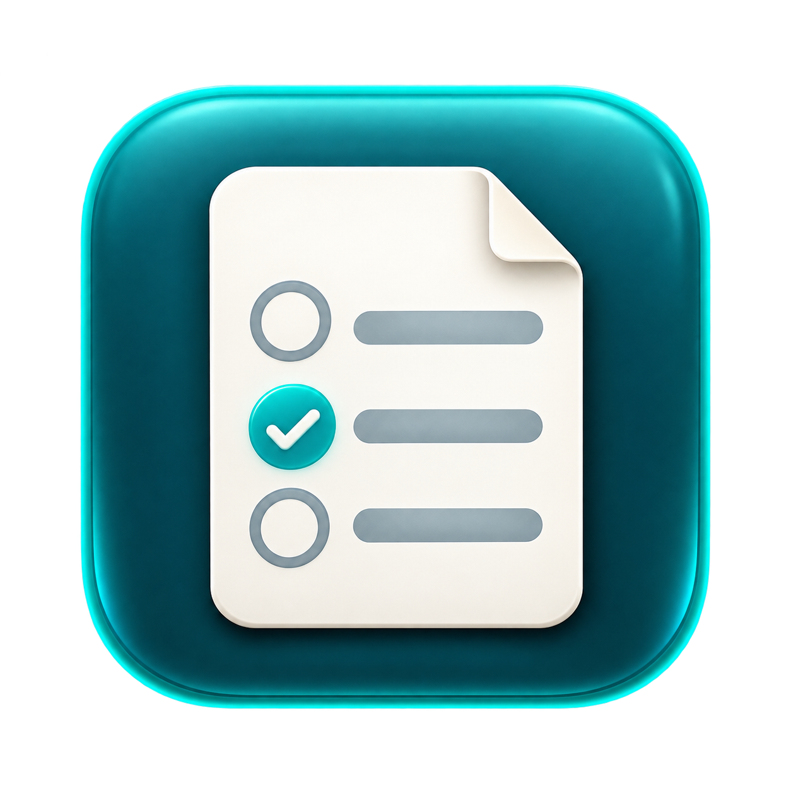

<p align="center">
  
</p>

# Clipboard AI Solver

스크린샷 속 객관식 문항을 OpenAI 또는 Claude로 읽고 풀이하는 macOS 메뉴 바 앱입니다. 메뉴 바에는 보기 번호를 표시하고, 최근 결과에서 인식한 문항·해설·출처를 확인할 수 있습니다. 브라우저 확장 없이 실행합니다.

**[v0.2.2 DMG 다운로드 · Apple Silicon](https://github.com/hjkim24/ai-solver/releases/download/v0.2.2/Clipboard-AI-Solver-0.2.2-arm64.dmg)** · [최신 릴리스](https://github.com/hjkim24/ai-solver/releases/latest) · [SHA-256](https://github.com/hjkim24/ai-solver/releases/download/v0.2.2/Clipboard-AI-Solver-0.2.2-arm64.dmg.sha256)

## 설치

현재 배포본은 **Apple Silicon(M 시리즈) · macOS 13 이상**용입니다. 인터넷 연결과 본인의 OpenAI 또는 Anthropic API 키가 필요하며, API 사용료는 별도입니다. ChatGPT·Claude 구독과 API 과금은 별개입니다. Intel Mac 배포본은 제공하지 않습니다.

1. 위 DMG를 열고 **Clipboard AI Solver.app**을 **Applications** 폴더로 드래그합니다.
2. 응용 프로그램 폴더에서 앱을 실행합니다. 메뉴 바에 **—**가 표시됩니다.
3. 최초 실행이 차단되면 **시스템 설정 → 개인정보 보호 및 보안 → 그래도 열기**에서 허용합니다. 이 앱은 자체 서명되어 있으며 Apple Developer ID 서명·공증을 받지 않았습니다. 관리되는 Mac에서는 실행이 제한될 수 있습니다. [Apple 안내](https://support.apple.com/ko-kr/102445)

자세한 절차는 [설치 안내](docs/INSTALL.ko.txt)를 참고하세요.

## 첫 사용

1. 메뉴 바 **— → 설정 → AI 연결**에서 **OpenAI · GPT** 또는 **Anthropic · Claude**를 선택합니다.
2. 해당 공급자의 API 키를 입력하고 **모델 불러오기 → 모델 선택 → 저장**을 누릅니다. 키는 공급자별 macOS 키체인에 저장됩니다.
3. **설정 → 일반**에서 풀이 방식을 선택합니다. 기본값인 **일반 AI**는 자료 없이 사용할 수 있습니다.
4. 메뉴의 **사용 시작**을 누른 뒤, 문제 하나와 모든 보기가 보이도록 준비해 이미지를 클립보드에 복사합니다.

| 입력 | 단축키 |
| --- | --- |
| 전체 화면을 클립보드에 복사 | **Control–Shift–Command–3** |
| 선택 영역을 클립보드에 복사 | **Control–Shift–Command–4** |

파일로만 저장하는 Shift–Command–3은 감지하지 않습니다. 사용 시작 전에 복사한 이미지와 텍스트·파일 경로 복사는 처리하지 않습니다. [Apple 캡처 안내](https://support.apple.com/ko-kr/guide/mac-help/mh26782/mac)

메뉴 바 숫자는 **위에서부터 1로 세는 보기 위치**입니다. `…`는 처리 중, `?`는 보류, `!`는 오류입니다. **최근 결과**에서 인식 내용과 해설을 원본에 대조하세요. **사용 중지**는 감시·진행 중인 풀이·LED 알림을 취소하며, 앱은 실행할 때마다 중지 상태로 시작합니다.

## 공급자와 모델

모델 ID를 직접 입력하지 않고 API에서 불러온 목록에서 선택합니다. 이미지 인식과 풀이에는 선택한 동일 공급자·모델을 사용합니다. 키·모델·자료 목록은 공급자별로 보존합니다.

- **OpenAI:** 계정의 [모델 목록 API](https://developers.openai.com/api/reference/resources/models/methods/list)와 [공식 모델 문서](https://developers.openai.com/api/docs/models/all)를 대조해 이미지 입력·구조화 출력·Responses 지원을 확인합니다. 문서의 모델 ID와 명시된 기본 스냅샷만 표시합니다.
- **Anthropic:** [모델 목록 API](https://platform.claude.com/docs/en/api/models/list)의 `image_input`·`structured_outputs` 지원 정보를 확인하고 모든 페이지를 조회합니다.

지원 정보를 확인하지 못한 모델은 제외합니다. 목록 조회가 실패하면 저장된 선택을 유지하며, 새 모델은 **모델 불러오기**로 갱신합니다. 키를 바꿀 때는 새 키로 목록을 조회한 뒤 저장하세요. 모델 접근 권한·잔액·문맥 제한은 실제 호출에서 추가로 확인될 수 있습니다.

## 자료와 풀이 모드

| 모드 | 동작 |
| --- | --- |
| 일반 AI | 등록 자료를 보내지 않고 이미지와 모델 지식으로 판단 |
| 첨부자료 우선 AI | 체크한 원본 자료를 우선 참고하고, 근거가 부족하면 모델 지식으로 보완 |
| RAG · 자료 근거만 | 준비된 자료를 검색하고 실제 검색 구절과 일치하는 인용을 검증. 근거가 없으면 보류 |

**자료 관리**에서 PDF·UTF-8 TXT·MD를 추가합니다. 공급자를 바꿔도 기존 자료를 보존하며, 공급자 사이에서 자동 이동하지 않습니다.

| 항목 | OpenAI | Claude |
| --- | --- | --- |
| 자료 보관 | OpenAI 계정에 업로드 | 이 Mac에 별도 사본 저장 |
| 원본 첨부 | 파일당 50 MB 미만, 합계 50 MB 이하 | 합계 12 MB 이하. PDF는 원본 문서, TXT/MD는 텍스트 문서로 전달 |
| RAG 검색 | OpenAI Vector Store | PDFKit 추출 텍스트·TXT/MD에서 로컬 어휘 검색, 상위 5개 구절 전달 |
| 자료 제거 | 원격 파일과 자료 연결 삭제 | Mac의 사본 삭제. 사용자가 선택했던 원본은 유지 |

Claude RAG는 임베딩 의미 검색이나 OCR을 수행하지 않아 동의어·스캔·그림 검색에 한계가 있습니다. 텍스트가 없거나 추출 텍스트가 2 MB를 넘는 파일은 **원본 첨부 전용**으로 표시합니다. 첨부자료 모드의 인용은 파일 ID만 검증하므로 원문 확인이 필요합니다. PDF 페이지·문맥 제한은 선택 모델에 따릅니다.

## Caps Lock LED

**설정 → 알림**에서 **정답 번호만큼 Caps Lock LED 깜빡이기**를 켜거나 **LED 3회 테스트**로 확인합니다. MacBook 내장 키보드용이며 Caps Lock 입력 상태·한영 입력 소스는 변경하지 않습니다.

처음 사용할 때 입력 모니터링을 요청하면 **시스템 설정 → 개인정보 보호 및 보안 → 입력 모니터링**에서 **Clipboard AI Solver**를 허용하고 앱을 재실행합니다.

0.2.1부터 같은 로컬 인증서를 재사용해 업데이트 간 코드 식별 조건을 유지합니다. 이전 임시 서명 버전에서 전환하는 최초 한 번은 기존 권한 항목을 제거하고 새 앱을 다시 추가해야 할 수 있습니다. 개발 중에도 같은 인증서·bundle ID·설치 위치를 유지해야 합니다. [서명·백업 안내](docs/SIGNING.ko.md)

**이 Mac에서는 0.2.1 → 0.2.2 실제 업데이트 후 권한 재등록 없이 LED 3회 점멸을 확인했습니다.** 다른 Mac·OS 버전은 별도 검증 대상입니다. 외장 키보드는 지원하지 않으며 강제 종료·전원 차단 시 LED 원복은 보장하지 않습니다.

## 전송 정보와 제한

- 사용 중 새로 복사한 **모든 이미지**가 처리 대상이며 선택한 AI 공급자로 전송됩니다. 전체 화면의 문제 외 내용도 포함됩니다. 이미지 내용은 앱이 디스크·로그에 저장하지 않습니다.
- 문항 인식 1회와 풀이 1회에 API를 호출합니다. OpenAI RAG는 중간 검색 요청이 추가됩니다. 이미지·첨부 입력은 호출별 과금이며 실패 시 자동 재시도하지 않습니다. OpenAI Responses는 `store: false`로 요청합니다.
- 단일 정답 객관식 한 문제, 보기 2~10개를 지원합니다. 여러 문제·잘림·판독 불가·복수 정답을 감지하면 보류합니다. AI가 잘못 읽거나 판단할 수 있으므로 인식 내용과 결과를 확인하세요.
- 전체 처리 제한은 45초입니다. RAG에 준비된 자료가 없으면 인식 API 호출 전 보류합니다.
- 입력 이미지는 64 MiB·40 MP·한 변 20,000 px 이하이며 정규화 PNG는 10 MiB 이하입니다. Claude는 추가로 한 변 8,000 px·PNG 7.5 MB 이하, 전체 JSON 요청 32 MB 이하를 검사합니다.
- 결과는 앱 메모리에만 유지하고 새 요청·사용 중지 시 지웁니다. 키는 키체인, 자료 목록과 설정은 UserDefaults에 저장합니다. Claude 자료 사본은 `~/Library/Application Support/Clipboard AI Solver/ClaudeMaterials`에 보관합니다.
- 앱은 브라우저 접근·화면 직접 녹화·답안 자동 입력·제출을 수행하지 않습니다.

## 개발

macOS, Xcode Command Line Tools(Swift·`sips`·`iconutil`), Python 3와 시스템 `openssl`·`security`가 필요합니다. macOS 13을 타깃으로 현재 Mac 아키텍처에 맞춰 빌드합니다.

```bash
git clone https://github.com/hjkim24/ai-solver.git
cd ai-solver
bash scripts/build.sh
open 'build/Clipboard AI Solver.app'
```

일반 설치·업데이트는 `bash scripts/install.sh`를 실행합니다. 앱을 정상 종료하고 서명 검증한 새 번들을 `/Applications/Clipboard AI Solver.app`에 설치합니다. 같은 bundle ID의 키·자료·설정을 유지하며 교체 실패 시 이전 앱을 복원합니다.

첫 빌드에서 `~/Library/Application Support/Clipboard AI Solver Signing`에 개발용 고정 서명 정보를 생성합니다. **이 폴더를 비공개로 보관·백업하고 매 빌드마다 재생성하지 마세요.** 이 저장소를 다른 Mac에서 새로 빌드하면 다른 인증서가 생성되므로 기존 배포본의 권한을 자동으로 이어받지 않습니다. 공식 Developer ID 서명·공증과는 별개입니다.

```bash
bash scripts/check.sh
python3 -B Tests/SigningCheck.py
python3 -B Tests/AppInstallCheck.py
python3 standalone/smoke.py
```

검사는 합성 이미지·이름이 분리된 클립보드·모의 HTTP·임시 앱/키체인을 사용합니다. 개인 API 키·일반 클립보드·유료 추론은 사용하지 않습니다. GUI와 키체인에 접근 가능한 로컬 macOS 터미널에서 실행하세요. SigningCheck·AppInstallCheck·smoke는 먼저 빌드한 앱이 필요합니다.

### 배포

```bash
bash scripts/package.sh
```

현재 빌드의 서명을 보존해 `dist/Clipboard-AI-Solver-<버전>-<아키텍처>.dmg`와 `.dmg.sha256`을 생성합니다. 기존 배포 파일은 덮어쓰지 않습니다. DMG에는 앱·Applications 링크·설치 안내만 포함합니다. 개인 API 키·설정·자료·빌드용 서명 키체인은 포함하지 않습니다. DMG는 Git에 넣지 않고 GitHub Releases에 첨부합니다.

### 코드 구성

| 경로 | 역할 |
| --- | --- |
| `standalone/Sources/` | 현재 앱의 설정·클립보드·Claude·모델 목록·로컬 자료 처리 |
| `Sources/AISolver/` | 공통 모델·OpenAI·작업 취소·LED와 구 앱 소스 |
| `standalone/Tests/`, `Tests/` | 모의 API·네이티브 UI·설치·서명 검사 |
| `scripts/` | 빌드·검사·서명·설치·DMG 생성 |
| `standalone/Resources/` | 앱 아이콘·Info.plist·아이콘 생성 프롬프트 |
| `extension/`, `scripts/legacy-*` | 보관 중인 구 Canvas 확장 방식. 현재 앱 실행에는 필요 없음 |

아이콘은 내장 이미지 생성 도구로 제작했습니다. 원본과 [생성 프롬프트](standalone/Resources/AppIcon.prompt.txt)를 보관하며 `bash standalone/make-icon.sh`로 ICNS를 재생성합니다. 변경 제안은 재현 절차와 검증 결과를 포함해 Issue 또는 Pull Request로 남겨 주세요. 키·개인 문항·사용 자료는 첨부하지 마세요.

## 검증 상태

- 이전 OpenAI 일반 AI·첨부자료 우선 AI: 사용자 실제 동작 확인.
- GPT/Claude 선택·모델 필터·인식/풀이·설정·자료 처리: 모의 HTTP, 합성 이미지, 임시 자료와 격리 UI로 검증. 공개 OpenAI 모델 문서는 실제 조회·파싱 확인.
- 서명·설치·배포: 변경된 두 빌드의 서명 호환, 다른 서명 주체 배제, 설치 실패 시 복원, DMG 구성·서명·체크섬 확인.
- 0.2.1 → 0.2.2 업데이트의 LED 권한 유지: 사용자 실제 확인.
- 새 Claude 경로의 실제 계정·유료 추론, RAG 정확도·지연의 정량 평가와 다른 Mac·OS 조합은 아직 별도 확인이 필요합니다.

구 Canvas 확장 방식의 기록은 [보관 문서](docs/legacy-extension.md)에 있습니다.
