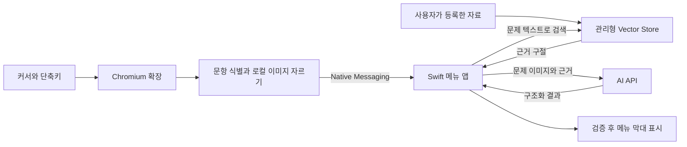

# Canvas RAG Solver — 제품·기술 스펙 v1

- 작성일: 2026-10-15
- 상태: 구현 전 검토용 스펙. 실제 LearningX 화면·API·키보드에서의 동작을 검증한 문서가 아니다.
- 관련 계획: [구현 계획](../plans/2026-10-15-canvas-rag-solver.md)

## 1. 목적과 결정의 출처

Canvas/LearningX에서 문제 번호에 커서를 올리고 단축키를 누르면, 해당 문항의 본문·보기·그림을 자동 캡처한다. 미리 등록한 자료에서 관련 구절을 검색하고 그 근거로 AI가 풀이한 답 번호를 macOS 메뉴 막대에 표시한다.

| 구분 | 내용 |
| --- | --- |
| 사용자 확정 | macOS, Chromium 기반 브라우저, Canvas/LearningX, AI API 키, RAG |
| 사용자 추가 조건 | 대상 문항의 본문과 보기는 대체로 화면 안에 들어옴. 한 화면에 여러 문항이 보일 수 있으며 이를 검증해야 함 |
| 이 스펙의 설계 결정 | Chromium 확장 + Swift 메뉴 앱, 단축키 입력당 한 문항 처리, OpenAI 관리형 검색과 Responses API |
| 초기 기본값 | `Command + Shift + Y`, 보기 2~10개인 단일 정답 객관식, 한 사이트·브라우저·프로필, 자료 모음 하나 |
| 확인이 필요한 환경 | 실제 사이트 origin, 브라우저 제품·버전, 문제 화면의 HTML/프레임 구조, 등록 자료의 추출 품질 |

이 스펙이 동작·데이터·검수 기준의 기준 문서다. 구현 계획과 차이가 있으면 이 스펙을 따른다. 미확인 환경을 범용 지원이 완료된 것으로 간주하지 않는다.

## 2. 첫 버전의 범위

### 포함

- 여러 문항이 함께 보이는 화면에서 커서가 가리킨 문항 하나를 선택한다. 화면 전체의 문항 수를 1개로 제한하지 않는다.
- 브라우저에서 단축키로 캡처·자료 검색·풀이를 시작한다. 별도 클릭이나 캡처 영역 드래그는 요구하지 않는다.
- 자료 여러 개를 등록·조회·삭제하고 인덱싱 상태를 표시한다.
- 메뉴 막대 번호와 최근 결과의 문항 번호·선택지·짧은 근거·파일명을 제공한다.
- 잘못된 범위·불충분한 근거·오래된 응답을 숫자 정답으로 표시하지 않도록 검증한다.

### 후속 또는 제외

- Caps Lock LED 출력은 메뉴 막대 버전 이후 실제 기기에서 독립 점등과 원복을 검증한 뒤 추가한다.
- 자동 정답 클릭·제출, 클립보드 상시 감시, 자동 스크롤·긴 문항 합성, 범용 화면 OCR 탐지, 복수 정답 문항, 여러 문항의 동시 풀이, 여러 사이트·프로필 동시 지원은 포함하지 않는다.
- 확인하지 않은 cross-origin iframe, 이미지 하나로만 구성되어 검색용 본문 텍스트가 없는 문항, 컨테이너 밖 공통 지문이 필요한 화면은 첫 버전 지원 대상으로 등록하지 않는다.
- 별도 자체 서버·로그인 시스템·기록 DB·App Store 배포·상시 녹화는 추가하지 않는다.

## 3. 구성과 책임

| 구성 | 책임 | 보유하지 않는 것 |
| --- | --- | --- |
| 확장 | 대상 문항 식별, 단축키, 탭 캡처, 로컬 crop, 현재 탭·문서 상태, native port | API 키, 외부 API 호출 권한 |
| 메뉴 앱 | Keychain, 자료 관리, 검색·풀이 요청, 최신 요청 관리, 결과 검증·표시 | 브라우저 전체 화면의 원본 저장, Canvas 로그인 정보 |
| API 서비스 | 등록 자료 인덱싱·검색, 전달받은 문항의 풀이 | 앱이 전송하지 않은 주변 문항 |

확장은 API 키를 받지 않는다. 자료 선택·삭제와 키 설정은 native UI에서만 수행한다. 페이지나 native 메시지로 임의 파일 경로·API URL·시스템 명령을 실행하지 않는다.

## 4. 최초 설정과 일반 사용

1. 실제 사용하는 Chromium 브라우저 하나에 개인용 확장을 설치하고, 확장 ID에 연결된 native host를 등록한다.
2. 확장 동작으로 메뉴 앱을 연결한다. 브라우저의 `connectNative()` 포트 하나가 메뉴 앱 프로세스 하나를 유지한다.
3. 사용자가 현재 LearningX 사이트를 사용 대상으로 등록한다. origin만 보관하며 로그인 쿠키·인증 토큰을 수집하지 않는다.
4. 메뉴 앱에서 API 키를 저장하고 자료를 등록한다. 첫 연결 검증 모델은 `gpt-4.1-mini`이며 설정에서 모델 ID를 변경할 수 있다. 이 모델의 과목별 정답률은 아직 검증하지 않았다.
5. 준비된 자료가 하나 이상 있을 때 메뉴의 `사용 시작`을 선택한다. 새 연결은 기본적으로 사용 중지 상태다.
6. 사용자가 본문 문제 번호 또는 문항 내부에 커서를 올리고 단축키를 누른다. 같은 화면에 다른 문항이 있어도 처리한다.
7. 앱은 기존 결과를 먼저 지우고, 선택한 문항만 캡처해 검색·풀이한다. 일상 사용 시 매번 미리보기나 전송 확인을 요구하지 않는다.
8. 번호가 표시되면 최근 결과 메뉴에서 문항 번호·원래 보기 라벨·근거·자료명을 확인할 수 있다.

단축키는 브라우저가 활성화된 상태에서 동작한다. 등록 충돌이 있으면 브라우저 단축키 설정 변경 방법을 보여 준다. 첫 버전에서 별도의 macOS 전역 키 감시는 하지 않는다.

## 5. 문항 선택 요구사항

### SEL-01: 문항 식별

단축키로 실행된 첫 DOM 스냅샷의 `:hover` 체인에서 가장 안쪽 요소를 얻고, 검증된 사이트 어댑터가 정의한 정규 문항 컨테이너를 찾는다. 대상 스냅샷은 native 준비 응답을 기다리기 전에 채취하고 그 뒤에는 커서 위치를 다시 읽어 대상을 바꾸지 않는다. 정규 컨테이너는 본문·보기·문항 내부 그림을 포함하는 단일 문항의 경계다.

- 표시 번호를 전역 검색하여 첫 일치 문항을 선택하지 않는다. 사이드바에 같은 번호가 있어도 본문 문항 선택으로 해석하지 않는다.
- 컨테이너 후보가 서로 다른 문항 두 개 이상이거나, 모든 문항을 감싼 부모 영역만 발견되면 선택 실패다.
- 같은 문항의 중첩 wrapper는 어댑터가 하나의 정규 컨테이너로 정규화한다. 서로 다른 문항의 경계를 합치지 않는다.
- 내부 문항 키는 문서 세션과 실제 컨테이너의 식별자로 구성한다. 화면에 표시된 번호만으로 문항을 식별하지 않는다.
- 커서가 문항 간 여백·사이드바·제출 버튼·메뉴 위에 있으면 전송하지 않는다.

### SEL-02: 여러 문항이 보이는 화면

화면의 전체 문항 개수와 선택 결과의 문항 개수를 구분한다. 전체 문항은 여러 개여도 되며, 선택 결과에는 한 문항만 있어야 한다.

- 예: 화면에 3·4·5번 문항이 보이고 커서가 4번 번호에 있으면 4번 본문·보기·그림만 포함한다.
- 3번 또는 5번의 본문·보기·문항 번호는 전송되는 이미지와 문제 텍스트에 포함하지 않는다.
- 다른 문항이 화면 밖으로 일부 잘려 있어도 선택한 문항이 온전히 보이면 허용한다.
- 대상 스냅샷을 얻은 뒤 커서를 다른 문항으로 옮겨도 처리 대상은 바꾸지 않는다. 새 단축키를 눌렀을 때 새 문항을 선택한다.

### SEL-03: 내용과 가시성

- 본문과 화면에 보이는 보기 2~10개를 읽는다. 보기 순서는 사용자가 읽는 화면 순서와 일치해야 한다.
- 선택한 문항의 본문·보기·필수 그림이 viewport와 알려진 clipping 영역 안에 온전히 있어야 한다. 숨겨진 보기나 잘린 본문은 성공 조건으로 인정하지 않는다.
- 컨테이너 밖 공통 지문이나 그림이 필요하거나 알려진 고정 헤더·대화상자에 필수 정보가 가려진 레이아웃은 지원 검증 전 거절한다.
- 실제 어댑터에서 검증하지 않은 화면에는 범위를 추측한 전송을 하지 않는다. 일반 이미지 분석을 이용한 범위 탐지는 별도 후속 설계다.

## 6. 캡처와 문서 일관성

### CAP-01: 캡처 범위

- `tabs.captureVisibleTab()` 결과는 확장 메모리에서만 보관한다. native 앱에 전달하기 전에 선택한 문항 사각형으로 자른다.
- 선택한 컨테이너의 외곽 사각형을 사용하고 추가 여백은 넣지 않는다. 소수점 좌표는 시작을 내림, 끝을 올림하여 텍스트 경계가 잘리지 않도록 한다. 이때 생기는 배경·경계선 1픽셀 오차와 다른 문항 내용 혼입은 구별한다.
- 픽셀 변환은 실제 이미지 가로·세로 크기와 CSS viewport 크기의 비율로 계산한다. 브라우저 확대와 Retina 배율을 중복 적용하지 않는다.
- native에 보내는 PNG는 디코딩된 파일 바이트 기준 10 MiB 이하다. 크기 초과·손상·빈 이미지는 실패로 처리하고 외부 API에 보내지 않는다.
- 임시 이미지 파일·클립보드 쓰기를 사용하지 않는다. 캡처 원본과 crop은 작업 종료·취소 시 해제한다.

### CAP-02: 캡처 전후 일치

문항 선택 시 탭·문서 세션, 문항 키, 본문·보기 텍스트, 문항 사각형, viewport, 스크롤 위치를 스냅샷으로 보관한다. 캡처 후 다시 읽어 동일한지 검사한다.

탭 전환·문서 이동·스크롤·크기 변경·문항 내용 변경이 있으면 해당 캡처를 폐기한다. radio 선택 여부처럼 문제 내용과 무관한 입력 상태는 본문 fingerprint에 포함하지 않는다. 이 기능은 답을 변경하지 않는다.

처리 중뿐 아니라 선택한 문항이 최근 결과인 동안에도 해당 문서 상태를 감시한다. 브라우저 탭 이동, 대상 문서 이동, 스크롤·크기 변경, 대상 본문·보기 변경은 완료된 결과도 지운다. Mac 메뉴를 여는 것만으로 결과를 지우지는 않는다.

## 7. RAG 자료 관리와 검색

### RAG-01: 자료 모음

- 첫 버전은 자료 모음 하나에 여러 PDF/TXT/MD 파일을 등록한다. 디렉터리 전체를 자동 업로드하지 않는다.
- 로컬 원본은 수정하지 않는다. 읽을 수 없는 파일·빈 파일·지원하지 않는 형식은 업로드 전에 거절한다.
- 파일별 상태는 `업로드 중`, `인덱싱 중`, `준비됨`, `실패`, `삭제 중`, `삭제 실패`로 표시한다. 인덱싱 완료가 내용 전체의 정확한 추출을 보증하지는 않는다.
- 준비된 파일 ID만 검색·인용에 허용한다. 등록·삭제·준비 상태 변경으로 허용 파일 집합이 바뀌면 진행 중 작업과 최근 결과를 무효화한다.
- 앱이 생성한 Vector Store ID와 관리하는 파일 ID·상태는 로컬 설정에 보관한다. API 키는 이 설정에 넣지 않는다.
- 삭제 시 앱이 생성한 Vector Store 연결과 원격 Files 객체를 모두 정리한다. 일부 실패를 완료로 표시하지 않고 재시도할 수 있게 한다. 삭제를 시작한 파일은 검색 근거에서 즉시 제외한다.
- 종료·재실행 뒤 자료 상태를 서버와 대조한다. 중단된 업로드·삭제를 자동 성공으로 간주하지 않는다.

### RAG-02: 검색

- 본문과 보기 텍스트의 불필요한 공백을 정리하여 검색 질의를 만든다. 검색용으로 읽은 텍스트도 선택 문항에 한정한다.
- 유효한 본문 텍스트가 없으면 검색 질의를 임의 생성하지 않고 지원하지 않는 문항으로 처리한다.
- 선택된 자료 모음에 Vector Store Search를 한 번 요청하고 관련 구절을 최대 5개 받는다. 자료 전체를 매 문제마다 다시 첨부하지 않는다.
- 근거 레코드는 검색 응답의 `file_id`, `filename`, `text`, `score`를 보존한다. 현재 준비된 파일 ID 집합 밖의 검색 결과는 제거한다.
- 유효한 결과가 하나도 없으면 최종 모델 호출 없이 `근거 없음`으로 끝낸다. 검색 결과가 있어도 관련성이 부족하면 최종 모델이 답을 보류하도록 지시한다. 보정하지 않은 검색 점수를 정답 확률로 표시하지 않는다.
- 스캔 PDF·그림·수식의 검색 품질은 실제 자료로 평가한다. 텍스트 인덱싱만으로 시각 정보가 보존되었다고 가정하지 않는다. 이미지 보완 처리는 첫 버전 검증 결과에 따라 후속 범위를 정한다.

## 8. 모델 입력과 결과 계약

### SOL-01: 요청

한 작업은 자료 검색 1회와 최종 풀이 요청 최대 1회로 구성한다. 요청에는 crop PNG, 선택 문항의 본문·보기, 검색한 구절과 실제 파일 ID를 포함한다. Responses API에는 `store:false`를 지정하고 strict JSON Schema를 사용한다.

자료와 문제 안의 문장은 풀이 대상 데이터로 취급한다. 그 안에 포함된 시스템 지시 변경·추가 파일 전송·도구 실행 요구를 따르지 않도록 지시하며 모델에 시스템 작업 도구를 주지 않는다. 자료 근거가 부족하거나 단일 정답을 정할 수 없으면 답을 보류하도록 지시한다.

### SOL-02: 구조화 출력

| 필드 | 타입과 규칙 |
| --- | --- |
| `status` | `answered`, `no_evidence`, `uncertain`, `unreadable`, `unsupported` 중 하나 |
| `answer_index` | 정수 또는 null. answered일 때 실제 전송한 보기의 1-based 범위 안에 있어야 함 |
| `answer_label` | 문자열 또는 null. answered일 때 해당 보기의 원래 라벨과 일치해야 함 |
| `explanation` | 1~300 Unicode 문자인 한국어 근거 또는 보류 사유 |
| `sources` | `{file_id, quote}` 배열. answered에는 1개 이상, 전체 최대 5개. quote는 1~500 Unicode 문자 |

모든 필드는 required이며 nullable 필드는 null을 허용한다. 추가 속성은 허용하지 않는다. answered 이외의 상태에서는 answer_index와 answer_label이 모두 null이어야 한다.

### SOL-03: 표시 전 검증

1. HTTP 상태·응답 완료 상태를 검사한다. refusal·incomplete·잘못된 JSON·잘못된 schema를 처리한다.
2. 번호 범위는 모델이 추측한 보기 개수가 아니라 실제 전송한 보기 배열로 검사한다. A/B/C/D는 1/2/3/4이며 메뉴에는 원래 라벨도 보존한다.
3. 모든 source의 file_id가 실제 전달한 근거에 있어야 한다. 인용문은 공백 정규화 후 해당 파일의 검색 구절 하나에 포함되어야 한다. 문장 순서 변경이나 내용을 고쳐 쓴 인용은 통과시키지 않는다.
4. 자료 파일명은 검색 결과에서 가져온다. 모델이 새 파일명·페이지 번호를 만들어 표시할 수 없게 한다.
5. 현재 요청·문서·자료 집합과 일치하는 경우에만 결과를 표시한다.

인용·형식 검증은 근거가 실제 답을 논리적으로 뒷받침하는지까지 증명하지 않는다. AI 오답과 검색 누락은 실제 표본 평가에서 별도로 집계한다.

## 9. 요청 수명과 메뉴 상태

### JOB-01: 최신 요청 하나

- 단축키를 수락할 때 새 request_id를 만들고 이전 결과와 작업을 먼저 무효화한다. 새 범위 탐지가 실패해도 이전 답을 유지하지 않는다.
- 동시에 유효한 작업은 하나다. 새 요청은 이전 캡처·검색·풀이를 취소하고 그 뒤 도착한 모든 응답을 무시한다.
- 사용자 중지, 탭/문서 상태 변경, 자료 집합 변경, native 연결 종료, 앱 종료도 같은 규칙으로 무효화한다.
- 성공과 실패 모두 request_id를 확인한다. 오래된 실패가 새 성공을 덮어쓰는 것도 금지한다.
- 단축키 수락부터 45초를 결과 표시 제한 시간으로 한다. 확장과 앱은 남은 시간 안에서 작업하며 제한 시간 이후의 결과는 표시하지 않는다. 자동 API 재시도·재풀이를 하지 않는다.
- 취소는 화면과 작업의 유효성을 취소하는 동작이다. API에서 이미 처리한 비용이 환급된다는 의미로 표시하지 않는다.

### JOB-02: 상태 표시

| 내부 상태 | 메뉴 막대 | 최근 결과·상태 설명 |
| --- | --- | --- |
| `disabled`: 사용 중지 | `—` | 사용 중지 |
| `ready`: 준비된 상태, 새 입력 대기 | `·` | 단축키로 문제 선택 |
| `locating` / `capturing` / `searching` / `solving` | `…` | 처리 중인 단계와 선택 문항 번호 |
| `answered`: 검증을 통과한 답 | `1`~`10` | 문항 번호, 보기 순서·원래 라벨, 근거, 파일명, 처리 시각 |
| `deferred`: 범위 불명확·지원 밖·근거 없음·모델 보류 | `?` | 구체적인 보류 사유 |
| `error`: 설정·권한·캡처·연결·인증·timeout·응답 오류 | `!` | 구체적인 오류와 필요한 다음 행동 |

메뉴는 `사용 시작/중지`, `최근 결과`, `자료 관리`, `설정`, `종료`로 제한한다. 최근 결과는 메모리에 하나만 보관한다. 결과 표시로 창을 열거나 포커스를 이동하지 않는다.

## 10. 확장·앱 통신과 데이터 경계

### IPC-01: 연결

- 확장 권한은 `activeTab`, `scripting`, `storage`, `nativeMessaging`이다. 기본 설치에 광범위한 상시 사이트 접근을 추가하지 않는다.
- allowed_origins는 설치된 확장 ID 하나로 제한한다. 앱도 호출 origin과 메시지를 검사한다.
- 기본 포트 하나를 유지한다. 연결이 끊어지면 작업을 취소하고 사용 중지 상태로 끝낸다. 이전 이미지나 요청을 새 포트에 자동 재전송하지 않는다.
- 브라우저 제품별 사용자 native-host 등록 경로와 실행 파일의 절대 경로를 설치 단계에서 결정한다.
- cross-origin 프레임은 activeTab만으로 접근할 수 있다고 가정하지 않는다. 실제 화면이 해당 형태면 어댑터·권한 검토를 별도로 완료해야 지원한다.

### IPC-02: 메시지 계약 v1

| 방향·type | 필수 내용 | 처리 |
| --- | --- | --- |
| 확장 → 앱 `begin` | version=1, request_id | 기존 작업 무효화, 새 요청 등록. 수락 시 locating으로 응답하고 수락된 요청만 캡처 진행 |
| 확장 → 앱 `solve` | version=1, request_id, remaining_ms, question, png_base64 | 현재 요청에 한해 이미지 검증 후 검색·풀이 |
| 확장 → 앱 `cancel` | version=1, request_id, reason | 일치하는 요청만 취소. 오래된 cancel이 최신 요청을 취소할 수 없음 |
| 앱 → 확장 `state` | version=1, request_id 또는 연결 상태용 null, state, message | 연결 상태 또는 현재 요청의 상태·실패 전달 |

공통 version은 정수 1, request_id는 확장에서 생성한 UUID 문자열이다. state는 JOB-02의 영문 값 중 하나이고 message는 사용자용 한국어 문자열이다. 연결 상태용 request_id=null은 특정 작업의 결과를 갱신하는 데 사용하지 않는다.

| question 필드 | 타입과 의미 |
| --- | --- |
| `page_session_id` | 비어 있지 않은 문자열. 문서 세션 식별자 |
| `question_key` | 비어 있지 않은 문자열. 해당 문서 안의 정규 문항 식별자 |
| `question_number` | 문자열 또는 null. 화면의 표시 번호. 없으면 UI에 선택한 문항으로 표시 |
| `stem_text` | 비어 있지 않은 문자열. 선택한 문제 본문 |
| `options` | `{index: Int, label: String, text: String}` 배열. index는 1부터 연속, text는 비어 있지 않음 |

표시 라벨이 없는 보기에는 화면 순서 번호를 label로 부여한다. question에는 다른 문항·로그인 정보·전체 페이지 HTML을 넣지 않는다. 번호 부재를 다른 문항의 번호로 보충하지 않는다.

- remaining_ms는 1~45000이고 확장 측 제한 시간의 남은 값 이하다. 앱의 검색·모델 요청도 이 시간 안으로 제한한다.
- 문제 본문과 보기 텍스트의 합은 UTF-8 기준 64 KiB 이하, 보기 개수는 2~10개다. 초과 입력은 몰래 잘라 보내지 않고 실패로 처리한다.
- native 프레임은 native byte order의 32-bit 길이와 UTF-8 JSON이다. 수신 JSON은 최대 16 MiB, 앱에서 확장으로 보내는 메시지는 1 MB 미만이다.
- 부분 읽기·여러 메시지 연속 수신·중간 EOF·손상 JSON·과대 길이·잘못된 base64를 처리한다. stdout에 로그를 섞지 않는다.
- API 키, 파일 업로드 지시, 삭제 지시, 임의 URL·파일 경로·실행 명령은 이 프로토콜에 포함하지 않는다.

## 11. 보관·개인정보·설정

| 데이터 | 보관 위치·수명 |
| --- | --- |
| API 키 | macOS Keychain. 조회·저장 실패를 표시하며 평문 설정에 복제하지 않음 |
| 모델 ID·Vector Store ID·관리 파일 ID/상태 | native 로컬 설정. 재시작 시 서버와 상태 대조 |
| 허용 사이트 origin·단축키 관련 설정 | 확장 로컬 설정·브라우저 단축키 설정 |
| 탭 캡처 원본·crop·문항 텍스트·현재 결과 | 처리에 필요한 메모리. 취소·컨텍스트 변경·종료 시 해제 |
| 등록 자료 | API 서비스에 저장. 사용자 삭제 동작으로 원격 파일과 연결을 정리 |

이미지·전체 문제·근거 전문·API 키·인증 헤더·쿠키를 로그에 남기지 않는다. 개발 로그는 단계·오류 코드·소요 시간·사용 토큰처럼 내용이 없는 값으로 제한한다. 페이지 전체 캡처는 외부로 전송하지 않는다.

API 방식은 등록 자료와 선택 문항을 외부 서비스로 전송한다. `store:false`를 완전 로컬 처리나 원격 자료 자동 삭제로 설명하지 않는다.

## 12. 필수 검증과 수락 기준

아래 항목은 구현 후 수행할 검수 항목이다. 현재 통과한 결과를 뜻하지 않는다.

### 12.1 문항 선택·캡처

| ID | 화면·동작 | 기대 결과 |
| --- | --- | --- |
| AC-01 | 한 문항, 번호에 커서 | 해당 문항 본문·모든 보기·그림만 포함 |
| AC-02 | 2개 문항, 각 번호를 차례로 선택 | 각각 독립 캡처. 앞뒤 문항 내용 혼입 0건 |
| AC-03 | 3개 문항, 첫째·가운데·마지막을 차례로 선택 | 3회 모두 선택한 문항 한 개만 전송 |
| AC-04 | 5개 문항이 보임, 가운데 문항 선택 | 화면 문항 수 때문에 실패하지 않고 대상만 선택 |
| AC-05 | 여러 문항 중 본문·보기·그림 위에 커서 | 같은 문항의 번호 위에서 선택했을 때와 동일한 영역 |
| AC-06 | 같은 번호가 사이드바에도 존재 | 본문 번호는 정확히 선택. 사이드바 번호는 전송 없음 |
| AC-07 | 문항 간 여백·부모 wrapper·제출 버튼 | 전송 없음, 이전 답 제거, 보류 사유 표시 |
| AC-08 | 인접 문항 번호가 반복되거나 문항 위치가 재정렬됨 | 표시 번호의 첫 일치를 고르지 않고 실제 대상 컨테이너를 선택 |
| AC-09 | 다른 문항은 일부 잘림, 선택 문항은 전체 보임 | 선택 문항 정상 처리 |
| AC-10 | 선택 문항의 본문·보기·필수 그림 일부가 잘림 | 전송 없음, 화면 조정 안내 |
| AC-11 | 컨테이너 밖 공통 지문·알려진 가림 요소 | 검증되지 않은 불완전 문항은 전송 없음 |
| AC-12 | 80/100/125/150% 브라우저 확대 및 실제 Retina 환경 | 올바른 crop. 텍스트 경계 누락·인접 문항 내용 혼입 없음 |
| AC-13 | 캡처 중 스크롤·탭 전환·문서 이동·크기 변경 | 이미지 폐기, 검색·모델 요청 없음 |
| AC-14 | 대상 스냅샷 이후 커서만 다른 문항으로 이동 | 처음 선택한 문항을 유지. 다음 단축키는 새 문항 선택 |

합성 fixture에는 문항별 서로 다른 문구와 시각 표식을 넣는다. 선택 이미지와 전송 텍스트에 이웃 문항의 문구·표식이 없는지 확인한다. 실제 사용 화면에서도 같은 선택 순서를 검증한다. 개발용 범위 표시·crop 미리보기는 검수에 사용하되 일상 전송 흐름에 추가 확인 단계를 강제하지 않는다.

### 12.2 RAG·결과·수명

| ID | 조건 | 기대 결과 |
| --- | --- | --- |
| AC-15 | 자료 없음·업로드/인덱싱 실패 | 준비 상태와 오류 표시, 유효 자료 없이 풀이 시작 없음 |
| AC-16 | 검색 결과 없음 또는 허용 파일 밖 결과만 반환 | 최종 풀이 호출 없이 근거 없음 |
| AC-17 | 보기 5개에 answer_index=6, 라벨 불일치, null 모순 | 숫자 답 표시 없음 |
| AC-18 | 모르는 출처 ID·검색에 없는 인용·필수 출처 누락 | 결과 검증 실패로 표시, 숫자 답 표시 없음 |
| AC-19 | refusal·incomplete·손상 JSON·401/429/5xx·timeout | 구분된 오류, 이전 답 미표시, 자동 재시도 없음 |
| AC-20 | A/B 선택 후 A 성공·실패가 B보다 늦게 도착 | B에 해당하는 현재 상태만 표시 |
| AC-21 | 처리 중 사용 중지·탭/문서/자료 변경·연결 종료 | 이전 결과·진행 작업 무효화, 늦은 응답 미표시 |
| AC-22 | 과대 메시지·부분 read/write·중간 EOF·손상 PNG | 잘못된 작업 실행 없음, 연결/입력 오류 처리 |
| AC-23 | 원격 삭제 일부 실패 또는 재시작 | 삭제 성공으로 표시하지 않음. 삭제 대상 인용 없음 |
| AC-24 | 실제 브라우저 연결·종료·재연결 | 포트당 메뉴 앱 한 개, 과거 요청 자동 재전송 없음 |

### 12.3 품질 측정과 기능 완료 조건

- 지원 레이아웃의 AC-01~AC-24를 통과하고 결과를 기록한다. 첫 지원 레이아웃·브라우저·origin을 README에 명시한다.
- 정답이 알려진 문제 20개를 사용한다. 여러 문항이 보이는 화면의 첫째·가운데·마지막 선택 사례를 포함한다.
- 캡처 오류, 검색 근거 부적합/누락, 모델 오답, 근거 있는 정답, 답 보류를 나누어 기록한다. 정답률의 분모에서 보류를 임의로 제외하지 않는다.
- 단축키부터 표시까지의 지연 중앙값·최댓값, 검색/모델 사용량과 당시 요금 기준 비용을 측정한다. API 취소 후 비용이 발생한 경우도 숨기지 않는다.
- 정답률과 지연은 사전 보장 수치로 두지 않는다. 기능 검수 통과와 과목별 풀이 품질 평가를 별도로 보고한다.
- 처음부터 실패·미지원으로 처리하기로 한 화면은 그 사유를 기록한다. 지원 레이아웃의 다중 문항 검증을 미지원 목록으로 옮겨 완료 처리하지 않는다.

## 13. 구현 착수 시 확인할 사실

| 확인 대상 | 확인 방법과 결과물 | 확인 전의 처리 |
| --- | --- | --- |
| 실제 LearningX origin·Chromium 제품/버전 | 현재 사용 화면과 브라우저 정보 확인, 설치·지원 환경 기록 | 도메인·native manifest 경로를 추정해 고정하지 않음 |
| 실제 문항 DOM·프레임·공통 지문 | 읽기 전용 구조 확인 후 정규 문항 selector와 합성 fixture 작성 | 범용 탐지·모든 Canvas 화면 지원을 주장하지 않음 |
| 자료의 텍스트·수식·그림 추출 | 등록 자료의 파싱 결과와 검색 표본 검사 | 인덱싱 완료를 내용 전체 이해로 표현하지 않음 |
| 실제 AI 응답과 모델 적합성 | 위 20문항 평가와 사용량 측정 | 검증 전 정답률·지연·비용을 확정하지 않음 |
| 키보드 LED | 메뉴 막대 버전 후 실기 점등·입력 상태 불변·복구 검사 | 첫 버전 완료 조건에 포함하지 않음 |

이 항목은 후속 구현에서 확인할 외부 환경이다. 스펙 작성 단계에서는 제품 코드 작성, 실제 사이트 검사, API 업로드·호출, 브라우저 설치 설정 변경을 수행하지 않았다.

## 14. 기술 근거

- [Chrome Commands: 단축키 등록·충돌·범위](https://developer.chrome.com/docs/extensions/reference/api/commands)
- [Chrome activeTab: 사용자 동작에 따른 현재 탭 접근](https://developer.chrome.com/docs/extensions/develop/concepts/activeTab)
- [Chrome tabs.captureVisibleTab: 보이는 탭 영역 캡처](https://developer.chrome.com/docs/extensions/reference/api/tabs#method-captureVisibleTab)
- [Chrome Native Messaging: 프로토콜과 macOS 등록](https://developer.chrome.com/docs/extensions/develop/concepts/native-messaging)
- [OpenAI Docs: Vector Store Search](https://developers.openai.com/api/reference/resources/vector_stores/methods/search)
- [OpenAI Docs: 이미지 입력](https://developers.openai.com/api/docs/guides/images-vision)
- [OpenAI Docs: 구조화 출력](https://developers.openai.com/api/docs/guides/structured-outputs?api-mode=responses)
- [OpenAI Docs: 데이터 보관 설정](https://developers.openai.com/api/docs/guides/your-data)
- [Instructure: Classic Quizzes와 New Quizzes 구분](https://community.instructure.com/en/kb/articles/660992-how-do-i-use-the-quizzes-index-page)
- [Instructure: New Quizzes의 iframe 제거 통합](https://community.instructure.com/en/discussion/comment/1255351)
